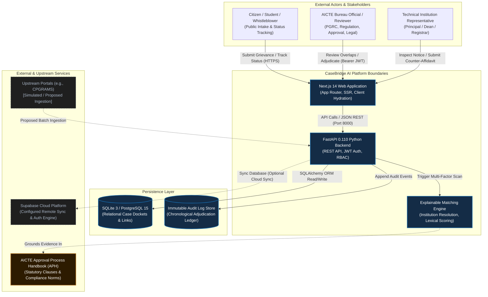
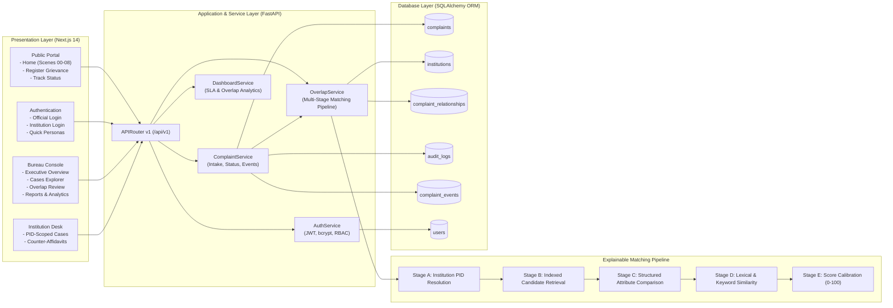
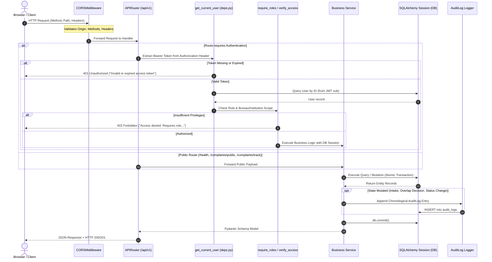
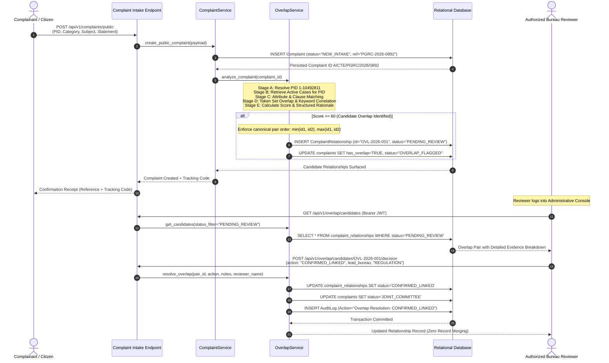
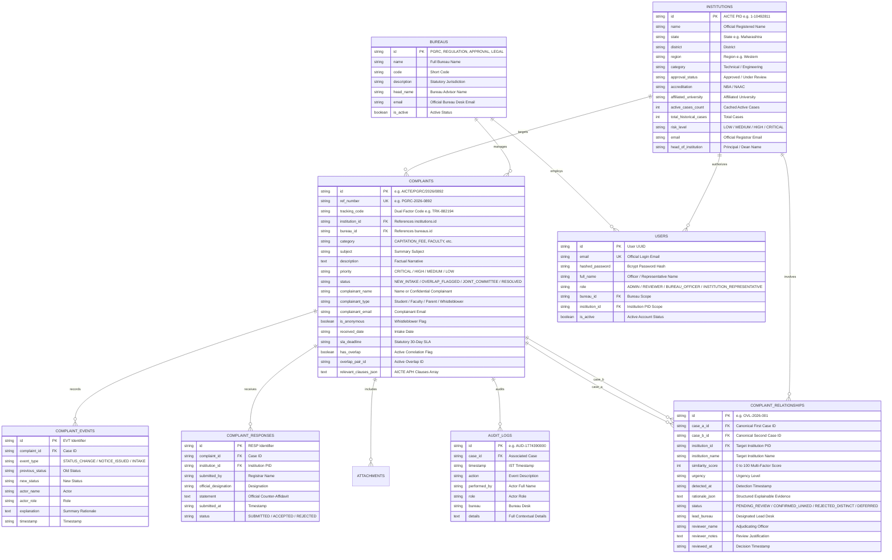
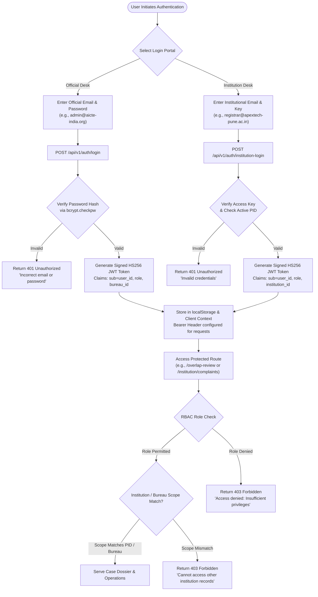
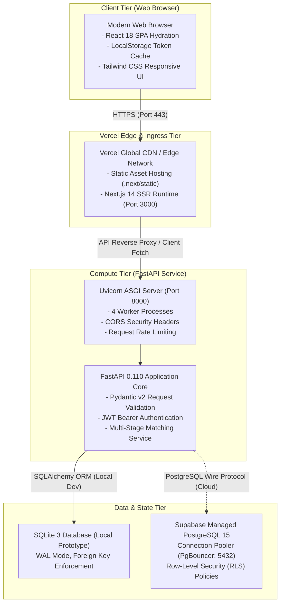
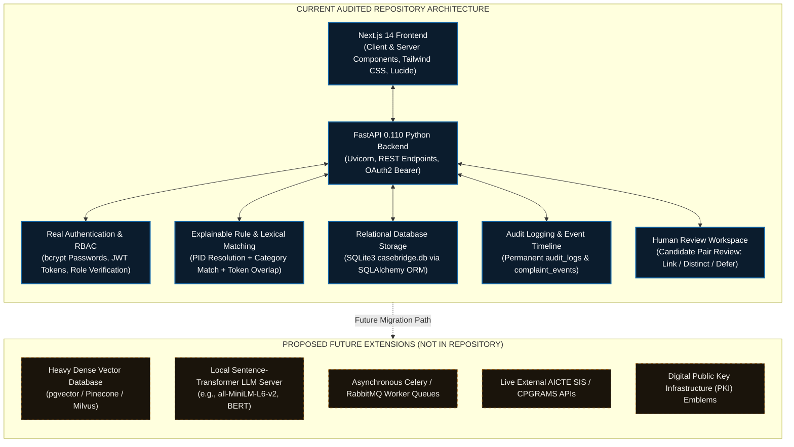

# CaseBridge AI — Presentation-Ready Architecture Diagrams
## Smart India Hackathon 2026 | Problem Statement ID: SIH26264

This document contains the complete collection of presentation-ready Mermaid architectural diagrams for **CaseBridge AI**, derived from the audited codebase of Team Code Ninja's.

---

## 1. System Context Diagram

---

## 2. High-Level Component Architecture

---

## 3. Backend Request Lifecycle & Security Middleware

---

## 4. Complaint Matching and Review Sequence Diagram

---

## 5. Database Entity-Relationship (ER) Diagram

---

## 6. Authentication and Authorization Flow

---

## 7. Deployment Architecture

---

## 8. Actual vs. Proposed Architecture Comparison

