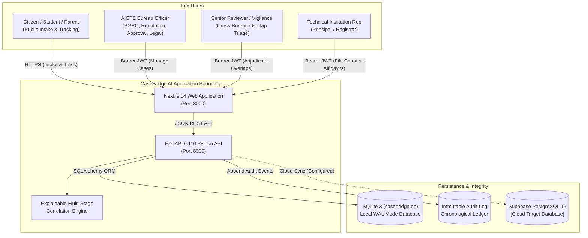
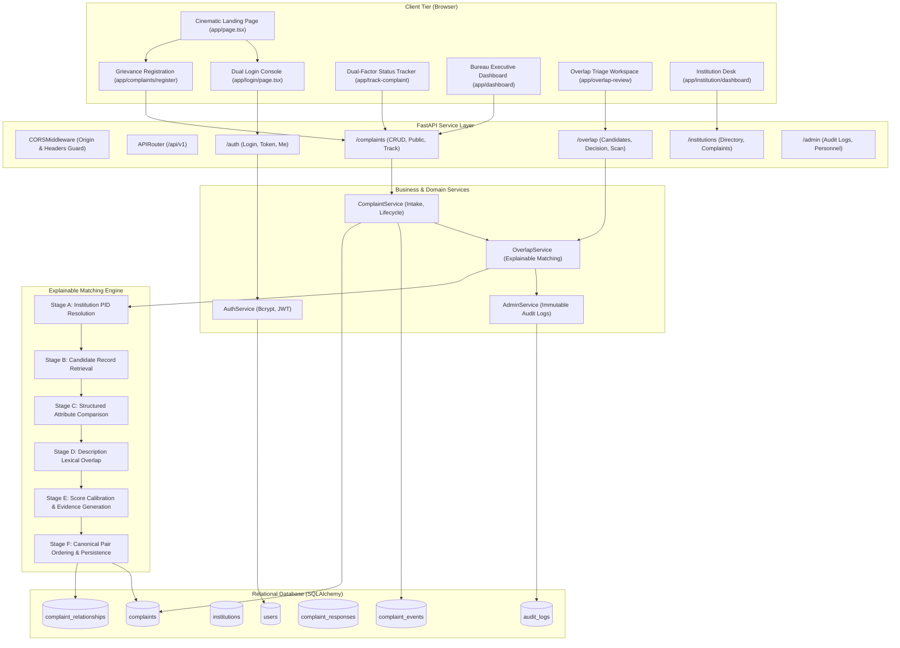

# CaseBridge AI — Complete System Architecture & Technical Audit
## Smart India Hackathon 2026 | Problem Statement ID: SIH26264
### Team: Code Ninja's | Topic: Integrated Dashboard for Monitoring and Tracking Institution-Related Complaint Cases Across AICTE Bureaus/Cells

---

## A. Executive Summary

### 1. Actual System Capabilities
CaseBridge AI is an institutional case coordination, grievance de-duplication, and compliance tracking platform designed for the All India Council for Technical Education (AICTE). The platform enables:
1. **Public Intake & Dual-Factor Tracking:** Citizens and students submit complaints against technical institutions and track case milestones using a non-guessable reference (e.g. `PGRC-2026-0892`) paired with an unguessable private tracking code (e.g. `TRK-882194`), protecting privacy without requiring account creation.
2. **Permanent Institute ID (PID) Resolution:** Grounds institutional grievances in verified AICTE Permanent Institute IDs (e.g. `1-10492811`), resolving variations in informal college names while flagging ambiguous submissions for administrative disambiguation.
3. **Cross-Bureau Overlap Triage:** Correlates active dockets across disparate administrative bureaus (PGRC, Regulation, Approval, Legal, CPGRAMS) targeting the same technical college.
4. **Explainable Multi-Factor Scoring:** Evaluates statutory PID match (+45), category match (+25), lexical description overlap (up to +25), and cross-bureau correlation (+5), presenting structured evidence rather than an opaque black-box probability.
5. **Sovereign Human Adjudication:** Enforces the non-negotiable principle that **a shared institution never triggers an automatic case merge**. Authorized officers confirm relationships (`CONFIRMED_LINKED`), mark distinct (`REJECTED_DISTINCT`), or defer decisions (`DEFERRED`).
6. **Immutable Audit Ledger:** Permanently records all administrative logins, candidate generations, reviewer decisions, and status mutations with actor identity, timestamp, and justification.
7. **Institutional Respondent Workspace:** Scopes technical institution representatives (principals/deans) strictly to their registered PID, enabling them to inspect formal show-cause inquiries and file official counter-affidavits.

### 2. Main Users and Personas
- **Citizens & Students:** Lodge public complaints, upload evidence documents, and track dual-factor status.
- **Bureau Officers (PGRC, Regulation, Approval, Legal):** Manage bureau-specific dockets, reassign cases, and issue notices.
- **Senior Reviewers & Chief Vigilance Officers (Admin):** Adjudicate candidate overlap pairs, convene Joint Scrutiny Committees, and designate Lead Bureaus.
- **Institution Representatives:** Principals and registrars accessing show-cause notices and filing compliance documentation.

### 3. Architectural Style
- **Full-Stack Decoupled Client-Server:** Next.js 14 App Router frontend consuming a stateless FastAPI 0.110 Python REST API.
- **Stateless Bearer JWT Authentication:** With Bcrypt password hashing and role-based access control (RBAC).
- **Hybrid Storage & Sync Architecture:** Local SQLite 3 (`casebridge.db`) with Write-Ahead Logging for rapid, zero-dependency evaluation, alongside Supabase PostgreSQL 15 migrations for production cloud deployment.
- **Defensive Multi-Tier Fallback:** The frontend remote client automatically falls back to an offline in-memory store if the backend process is unreachable, ensuring uninterrupted demonstration.

### 4. Present Implementation & Deployment Status
- **Backend API & Data Persistence:** Fully implemented, tested, and operational. 22 automated test scenarios passing in `pytest`.
- **Frontend Presentation & Design System:** Implemented with Next.js 14, Tailwind CSS, Lucide icons, and editorial styling matching the CaseBridge AI color palette (`#0B1C2D`, `#142C46`, `#1769AA`, `#F5F3ED`).
- **Production Build:** `next build` compiles all 24 static and dynamic routes with zero errors.

### 5. Five Most Important Technical Limitations
1. **Rule & Lexical Matching Baseline:** The matching engine uses structured PID, category, and lexical Jaccard token overlap. Dense vector embeddings (e.g. sentence-transformers) are designed in the roadmap but not bundled in the repo.
2. **Synthetic Demonstration Data:** The repository uses synthetic institutional dockets adhering to the AICTE Approval Process Handbook (APH 2025-26). It does not hold real AICTE live data.
3. **Stateless JWT Blacklisting:** Token revocation upon logout currently relies on client-side storage removal; server-side Redis token blacklisting is planned for staging.
4. **Binary Report Generation:** PDF docket exports are currently mocked in the UI; CSV and JSON exports are functional.
5. **SMS Gateway Credentials:** Dual-factor tracking is verified via private tracking code in database records; live SMS OTP dispatch requires CDAC/NIC gateway credentials.

---

## B. Repository Structure and Traceability

```
Case Sense/
├── app/                              # Next.js 14 App Router (Frontend Pages & Routing)
│   ├── globals.css                   # Global styles, Tailwind base, and CSS variables
│   ├── layout.tsx                    # Root layout with RoleProvider, ToastProvider, QueryProvider
│   ├── page.tsx                      # Cinematic 9-Scene Editorial Public Landing Page (Scenes 00-08)
│   ├── login/page.tsx                # Dual-Portal Login (Official Bureau + Institution Desk)
│   ├── dashboard/page.tsx            # Executive Bureau Overview & SLA Health Console
│   ├── cases/                        # Complaint Explorer & Docket Drill-down
│   │   ├── page.tsx                  # Searchable, filterable complaint master list
│   │   └── [caseId]/page.tsx         # Detailed case dossier with event timeline & evidence
│   ├── overlap-review/               # Cross-Bureau Overlap Triage Queue
│   │   ├── page.tsx                  # Candidate pairs list sorted by urgency & score
│   │   └── [pairId]/page.tsx         # Side-by-side comparison & human adjudication console
│   ├── institutions/                 # Approved Technical Institutions Directory
│   │   ├── page.tsx                  # Searchable directory with risk levels and PID
│   │   └── [instId]/page.tsx         # Institution profile, compliance score, and case history
│   ├── intake/page.tsx               # Internal official complaint lodging console
│   ├── complaints/                   # Citizen Grievance Portal
│   │   ├── register/page.tsx         # Step-by-step public complaint registration wizard
│   │   ├── confirmation/page.tsx     # Complaint submission receipt with tracking code
│   │   └── track/page.tsx            # Public status tracking query interface
│   ├── track-complaint/page.tsx      # Dual-factor citizen tracking console
│   ├── institution/                  # Institutional Respondent Portal
│   │   ├── login/page.tsx            # Dedicated institution access key login
│   │   ├── dashboard/page.tsx        # PID-scoped notice queue & compliance metrics
│   │   ├── complaints/page.tsx       # Institutional complaint explorer
│   │   ├── responses/page.tsx        # Counter-affidavit submission & document upload
│   │   └── profile/page.tsx          # Institutional registry details
│   ├── reports/page.tsx              # Analytics, charts, and statutory export console
│   ├── admin/access/page.tsx         # User governance & chronological audit log viewer
│   ├── about/page.tsx                # Project architecture & problem statement documentation
│   ├── how-it-works/page.tsx         # 5-stage de-duplication workflow walkthrough
│   └── help/page.tsx                 # Frequently asked questions & grievance guidelines
│
├── backend/                          # FastAPI Python Backend Service
│   ├── app/
│   │   ├── main.py                   # FastAPI entrypoint, CORS, lifespan seeding, exception handlers
│   │   ├── api/
│   │   │   ├── deps.py               # Dependency injection: get_current_user, require_roles, PID isolation
│   │   │   └── v1/
│   │   │       ├── router.py         # Master API router aggregating all v1 sub-routers
│   │   │       ├── auth.py           # /auth/login, /auth/institution-login, /auth/me
│   │   │       ├── complaints.py     # /complaints CRUD, /public intake, /track, /assign, /status
│   │   │       ├── overlap.py        # /overlap/candidates, /decision, /analyze
│   │   │       ├── institutions.py   # /institutions directory & PID complaint queries
│   │   │       ├── bureaus.py        # /bureaus workload and capacity metrics
│   │   │       ├── dashboard.py      # /dashboard/overview metrics and SLA aggregates
│   │   │       ├── reports.py        # /reports summary and statutory exports
│   │   │       └── admin.py          # /admin/audit-logs and /admin/users
│   │   ├── core/
│   │   │   ├── config.py             # Pydantic BaseSettings, CORS origins, JWT configurations
│   │   │   └── security.py           # Bcrypt password hashing & PyJWT encode/decode
│   │   ├── db/
│   │   │   ├── base.py               # SQLAlchemy DeclarativeBase
│   │   │   └── session.py            # SQLite / PostgreSQL engine & sessionmaker (get_db)
│   │   ├── models/                   # SQLAlchemy Database Models
│   │   │   ├── complaint.py          # Complaint table definition
│   │   │   ├── institution.py        # Institution table definition
│   │   │   ├── relationship.py       # ComplaintRelationship table with canonical ordering
│   │   │   ├── bureau.py             # Bureau table definition
│   │   │   ├── user.py               # User table with hashed_password and roles
│   │   │   ├── audit.py              # AuditLog table definition
│   │   │   ├── event.py              # ComplaintEvent chronological history
│   │   │   ├── response.py           # ComplaintResponse counter-affidavit model
│   │   │   └── attachment.py         # Attachment metadata model
│   │   ├── schemas/                  # Pydantic v2 Request & Response Data Contracts
│   │   │   ├── auth.py               # LoginRequest, Token, UserResponse
│   │   │   ├── complaint.py          # ComplaintCreate, PublicComplaintCreate, ResponseSchema
│   │   │   ├── overlap.py            # OverlapPairResponse, OverlapDecisionRequest, Rationale
│   │   │   ├── institution.py        # InstitutionResponseSchema
│   │   │   └── dashboard.py          # DashboardMetricsResponse
│   │   ├── seed/
│   │   │   └── seeder.py             # Initial database seeder for synthetic AICTE records
│   │   └── services/                 # Core Business Logic & Domain Services
│   │       ├── auth_service.py       # User & institution credential validation & token issuance
│   │       ├── complaint_service.py  # Complaint creation, status transitions, dual-factor tracking
│   │       ├── overlap_service.py    # Multi-stage candidate retrieval, scoring, adjudication
│   │       ├── institution_service.py# Institution filtering & PID compliance inspection
│   │       └── dashboard_service.py  # Aggregations, SLA counts, and bureau workloads
│   ├── tests/                        # Pytest Automated Test Suite (22 Scenarios)
│   │   ├── conftest.py               # Fixtures: TestClient, temporary SQLite DB, JWT tokens
│   │   ├── test_auth.py              # Tests login, invalid password, RBAC, cross-PID isolation
│   │   ├── test_complaints.py        # Tests intake, tracking, filtering, status updates
│   │   ├── test_dashboard.py         # Tests dashboard aggregations & metrics
│   │   └── test_overlap.py           # Tests candidate retrieval, scoring, human review decision
│   ├── alembic/                      # Database migrations
│   ├── requirements.txt              # Backend Python dependencies
│   └── casebridge.db                 # Active local SQLite3 database file
│
├── components/                       # Reusable React UI Components
│   ├── layout/                       # Application Shell, Sidebar, Topbar, Header, Footer
│   │   ├── AppShell.tsx              # Tri-portal layout switch (Public / Bureau / Institution)
│   │   ├── Topbar.tsx                # Search, persona switcher, notifications, sign out
│   │   ├── Sidebar.tsx               # Administrative navigation & pending badge counters
│   │   ├── PublicHeader.tsx          # Public website header with AICTE notice
│   │   ├── PublicFooter.tsx          # Public footer with national emblem citations
│   │   └── EnvironmentNotice.tsx     # Prototype disclaimer banner
│   ├── shared/                       # StatusBadge, PriorityBadge, BureauBadge
│   ├── cases/                        # CaseQuickDrawer, CaseFilterBar
│   └── landing/                      # CaseConnectionLab (interactive simulation)
│
├── lib/                              # Frontend Utility & API Service Layer
│   ├── api/
│   │   ├── remoteClient.ts           # Hybrid HTTP client connecting to FastAPI with store fallback
│   │   ├── store.ts                  # LocalStorage in-memory client state store
│   │   ├── seedData.ts               # Synthetic seed records for offline evaluation
│   │   └── types.ts                  # TypeScript domain models and interfaces
│   ├── context/
│   │   ├── RoleContext.tsx           # Authenticated user session, login, logout, persona state
│   │   └── ToastContext.tsx          # Global reactive notifications
│   ├── supabase/                     # Supabase client, data mapper, and auth service
│   │   ├── client.ts                 # Supabase JS SDK client initializer
│   │   ├── dataService.ts            # Supabase direct queries with store fallback
│   │   └── mappers.ts                # Database snake_case to frontend camelCase mappers
│   └── utils.ts                      # Tailwind CSS class merge helper (cn)
│
├── supabase/                         # Supabase Cloud Migrations & DDL
│   ├── full_setup.sql                # Complete PostgreSQL schema, tables, RLS, functions
│   └── seed.sql                      # PostgreSQL seed fixtures
│
├── package.json                      # Next.js 14 and React 18 dependencies
└── tailwind.config.ts                # Tailwind CSS configuration with institutional palette
```

---

## C. System Context Diagram



---

## D. Complete Application Architecture



---

## E. End-to-End Data Flow (11 Workflows)

### 1. User Login & Session Creation
- **Trigger:** Official or Institution representative enters credentials in [`app/login/page.tsx`](file:///app/login/page.tsx).
- **Endpoint:** `POST /api/v1/auth/login` or `POST /api/v1/auth/institution-login`.
- **Backend Service:** `AuthService.authenticate_user` in [`backend/app/services/auth_service.py`](file:///backend/app/services/auth_service.py#L14).
- **Database:** `SELECT * FROM users WHERE email = ?`. Password verified via `bcrypt.checkpw`.
- **Output:** JWT Bearer access token containing `sub=user_id`, `role`, and `bureau_id`/`institution_id`.
- **Client Session:** Stored in `localStorage` (`casebridge_jwt_token`) and dispatched to `RoleContext.tsx`.

### 2. Public Complaint Intake & Validation
- **Trigger:** Citizen completes 4-step wizard in [`app/complaints/register/page.tsx`](file:///app/complaints/register/page.tsx).
- **Endpoint:** `POST /api/v1/complaints/public`.
- **Backend Service:** `ComplaintService.create_public_complaint` in [`backend/app/services/complaint_service.py`](file:///backend/app/services/complaint_service.py#L191).
- **Database Operations:**
  1. Generates sequential Case ID (e.g. `AICTE/PGRC/2026/0892`) and Reference (e.g. `PGRC-2026-0892`).
  2. Generates private 6-digit Tracking Code (e.g. `TRK-882194`).
  3. Inserts into `complaints` with `status='NEW_INTAKE'`, `bureau_id='PGRC'`.
  4. Appends chronological record to `complaint_events`.
  5. Automatically triggers candidate overlap scan via `OverlapService.analyze_complaint`.

### 3. Institution Identity Resolution
- **Trigger:** Intake submission or search by college name.
- **Backend Service:** `InstitutionService.get_by_id` and PID normalization in `OverlapService`.
- **Logic:** Matches input against AICTE Permanent Institute ID (`1-10492811`). If PID is verified, institution confidence is 100%. If PID is missing, flags record for officer disambiguation rather than guessing.

### 4. Candidate Complaint Retrieval
- **Trigger:** Background scan during intake or manual scan trigger `POST /api/v1/overlap/analyze`.
- **Backend Service:** `OverlapService.analyze_complaint` in [`backend/app/services/overlap_service.py`](file:///backend/app/services/overlap_service.py#L28).
- **Query:** `SELECT * FROM complaints WHERE id != target.id AND status != 'RESOLVED' AND (institution_id = target.institution_id OR category = target.category)`.

### 5. Structured Attribute Matching
- **Backend Service:** `OverlapService.analyze_complaint`.
- **Attributes Compared:** Institution PID (45 pts), Complaint Category (25 pts), Bureau Jurisdiction (5 pts inter-bureau correlation bonus).

### 6. Text Similarity & Lexical Analysis
- **Backend Service:** `OverlapService.analyze_complaint`.
- **Logic:** Extracts normalized word tokens (&ge;4 characters) from both subject and description, computes intersection over union (Jaccard similarity), and scores up to 25 points for shared domain keywords (e.g. *faculty, capitation, withholding, salary, attendance*).

### 7. Candidate Score & Evidence Generation
- **Backend Service:** `OverlapService.analyze_complaint`.
- **Threshold:** If total score &ge; 60, constructs structured `rationale_json`:
  ```json
  {
    "same_institution": true,
    "institution_confidence": 100,
    "semantic_subject_similarity": 82,
    "matching_method": "HYBRID_STRUCTURED_AND_LEXICAL",
    "score_breakdown": {
      "institution_identity": 45,
      "category_match": 25,
      "text_similarity": 16,
      "cross_bureau_correlation": 5
    },
    "entity_matches": ["PID: 1-10492811"],
    "common_keywords": ["withholding", "original", "certificates"],
    "regulatory_clauses": ["AICTE Approval Process Handbook 2025-26"],
    "reason_description": "Surfaced candidate relationship: Overlapping grievance dockets detected between PGRC and REGULATION targeting 1-10492811."
  }
  ```

### 8. Human Review & Adjudication
- **Trigger:** Reviewer acts in [`app/overlap-review/[pairId]/page.tsx`](file:///app/overlap-review/[pairId]/page.tsx).
- **Endpoint:** `POST /api/v1/overlap/candidates/{pair_id}/decision`.
- **Backend Service:** `OverlapService.resolve_overlap`.
- **Actions:**
  - `CONFIRMED_LINKED`: Designates Joint Committee and Lead Bureau. Both dockets remain active.
  - `REJECTED_DISTINCT`: Marks complaints as distinct. Dockets return to independent investigations.
  - `DEFERRED`: Awaits formal institutional counter-affidavit.

### 9. Relationship Persistence & Canonical Ordering
- **Database Model:** `ComplaintRelationship` in [`backend/app/models/relationship.py`](file:///backend/app/models/relationship.py).
- **Integrity Rule:** Canonical pair ordering `(min(id1, id2), max(id1, id2))` enforced before write, preventing reverse duplicate records `(A, B)` and `(B, A)` under database unique constraint `uq_case_pair`.

### 10. Audit Event Creation
- **Backend Service:** `AuditLog` logger invoked on every mutation.
- **Database:** Inserts into `audit_logs` with unique ID `AUD-{timestamp}-{case_id}`, actor name, role, bureau desk, action description, and reviewer notes. Immutable (no update/delete routes).

### 11. Dashboard Analytics & Workload Health
- **Trigger:** Officer visits [`app/dashboard/page.tsx`](file:///app/dashboard/page.tsx).
- **Endpoint:** `GET /api/v1/dashboard/overview`.
- **Backend Service:** `DashboardService.get_overview`.
- **Data Returned:** Total complaints, active cases, pending overlap count, critical SLA breaches (&lt;5 days remaining), bureau workload distribution, and category breakdowns.

---

## F. Database Architecture & Integrity Analysis

### 1. Database Technology
- **Primary Runtime:** SQLite 3 (`casebridge.db`) with Write-Ahead Logging (WAL) and foreign key enforcement enabled (`PRAGMA foreign_keys=ON`).
- **Cloud Migration Target:** Supabase PostgreSQL 15 schemas defined in [`supabase/full_setup.sql`](file:///supabase/full_setup.sql).

### 2. Discovered Tables and Models

| Table Name | Primary Key | Foreign Keys | Key Constraints & Indexes | Cardinality / Relationships |
|---|---|---|---|---|
| `complaints` | `id` (VARCHAR 64) | `institution_id` &rarr; `institutions.id`<br/>`bureau_id` &rarr; `bureaus.id` | `UNIQUE(ref_number)`<br/>INDEX on `status`, `bureau_id`, `institution_id`, `has_overlap` | 1-to-N with `complaint_events`, `complaint_responses`, `attachments` |
| `institutions` | `id` (VARCHAR 64 - AICTE PID) | None | INDEX on `state`, `region`, `risk_level` | 1-to-N with `complaints` |
| `complaint_relationships` | `id` (VARCHAR 64) | `case_a_id` &rarr; `complaints.id`<br/>`case_b_id` &rarr; `complaints.id`<br/>`institution_id` &rarr; `institutions.id` | `UNIQUE(case_a_id, case_b_id)`<br/>INDEX on `status` | Links 2 complaints to 1 target institution |
| `complaint_events` | `id` (VARCHAR 64) | `complaint_id` &rarr; `complaints.id` | INDEX on `complaint_id`, `timestamp` | N-to-1 with `complaints` (Chronological history) |
| `complaint_responses` | `id` (VARCHAR 64) | `complaint_id` &rarr; `complaints.id`<br/>`institution_id` &rarr; `institutions.id` | INDEX on `complaint_id`, `institution_id` | N-to-1 with `complaints` (Institution counter-affidavits) |
| `audit_logs` | `id` (VARCHAR 64) | `case_id` &rarr; `complaints.id` (nullable) | INDEX on `case_id`, `timestamp` | Append-only adjudicative audit ledger |
| `bureaus` | `id` (VARCHAR 64) | None | `UNIQUE(code)` | 1-to-N with `complaints`, `users` |
| `users` | `id` (VARCHAR 64) | `bureau_id` (nullable)<br/>`institution_id` (nullable) | `UNIQUE(email)` | Officers scoped to bureau; reps scoped to PID |
| `attachments` | `id` (VARCHAR 64) | `complaint_id` &rarr; `complaints.id` | INDEX on `complaint_id` | Document uploads metadata |

### 3. Evaluation of Key Audit Inquiries
- **How the schema distinguishes institution identity from institution names:** The schema uses the AICTE Permanent Institute ID (`institutions.id` e.g. `1-10492811`) as the primary foreign key across `complaints` and `complaint_relationships`. The text `institution_name` is stored purely for display and presentation.
- **How the schema distinguishes original from linked complaint records:** Original complaints reside in `complaints`. Linked relationships reside in `complaint_relationships`. Linking never overwrites original complaint records.
- **How the schema distinguishes exact duplicates from potentially related complaints:** The `rationale_json` in `complaint_relationships` stores a discrete `score_breakdown` separating exact duplicates (&ge;85 score) from cross-bureau related inquiries (65–84 score).
- **How the schema distinguishes proposed matches from reviewer-confirmed relationships:** By the `status` column in `complaint_relationships`: `PENDING_REVIEW` represents algorithmic suggestions; `CONFIRMED_LINKED`, `REJECTED_DISTINCT`, and `DEFERRED` represent authorized human reviewer decisions.
- **How review decisions are separated from audit events:** Reviewer decisions mutate the relationship state in `complaint_relationships` and trigger status updates in `complaints`, while simultaneously appending an immutable, non-modifiable entry to `audit_logs`.

---

## G. AI/ML and Matching Architecture

### 1. Matching Pipeline Structure
The repository implements an explainable, deterministic multi-stage matching pipeline:

```
[Incoming Complaint]
         │
         ▼
[Stage A: Institution PID Resolution] ──▶ (Normalize AICTE PID 1-10492811)
         │
         ▼
[Stage B: Candidate Retrieval] ──────────▶ (Query DB for active cases with matching PID)
         │
         ▼
[Stage C: Structured Attribute Match] ───▶ (Compare category, subcategory, regulatory clauses)
         │
         ▼
[Stage D: Lexical & Token Overlap] ──────▶ (Tokenize narrative, remove stopwords, Jaccard overlap)
         │
         ▼
[Stage E: Calibrated Multi-Factor Score] ▶ (0-100 Score + Explainable JSON Rationale)
         │
         ▼
[Stage F: Canonical Pair Ordering] ──────▶ (Enforce min(A,B), max(A,B) & Persist Candidate)
```

### 2. Scoring Formulation
$$\text{Score} = S_{\text{institution}} + S_{\text{category}} + S_{\text{text}} + S_{\text{cross\_bureau}}$$
Where:
- $S_{\text{institution}} = 45$ if Permanent Institute ID matches.
- $S_{\text{category}} = 25$ if complaint categories match identically.
- $S_{\text{text}} = \min(25, |\text{Tokens}_A \cap \text{Tokens}_B| \times 4)$ for common keywords.
- $S_{\text{cross\_bureau}} = 5$ if complaints originate from distinct bureaus targeting the same college.
- Total score is capped at $98$ (leaving the remaining $2\%$ explicitly reserved for human discretion).

### 3. Preventing Score from Being Treated as Proof
The score is explicitly framed as an **advisory urgency indicator**:
- The UI labels scores as *"Algorithmic Correlation Index (Human Adjudication Required)"*.
- The API provides no endpoint to automatically resolve or merge complaints based on score thresholds.
- Only an authenticated official holding role `REVIEWER` or `ADMIN` can transition a relationship from `PENDING_REVIEW` to `CONFIRMED_LINKED`.

---

## H. Authentication, Authorization, and Security Audit

- **Bcrypt Password Storage:** Implemented in [`backend/app/core/security.py`](file:///backend/app/core/security.py) using `passlib.context.CryptContext(schemes=["bcrypt"])`. Passwords are never stored in plaintext.
- **Role-Based Access Control (RBAC):** Seven discrete roles defined: `ADMIN`, `REVIEWER`, `BUREAU_HEAD`, `INVESTIGATOR`, `PUBLIC_OFFICER`, `CITIZEN`, `INSTITUTION_REPRESENTATIVE`.
- **Horizontal Data Isolation:** Enforced in `verify_institution_access` in [`backend/app/api/deps.py`](file:///backend/app/api/deps.py#L74-L88). Institution users attempting cross-PID access receive HTTP 403 Forbidden.
- **SQL Injection Immunity:** All database operations utilize SQLAlchemy ORM with parameterized variable binding.
- **Whistleblower Confidentiality:** Serializers in [`backend/app/api/v1/complaints.py`](file:///backend/app/api/v1/complaints.py#L63-L68) suppress complainant contact information when `is_anonymous` or `is_confidential` is set.

---

## I. Testing, Verification, and Quality Assurance

### 1. Test Suite Inventory
- **Backend Tests (`backend/tests/`):** 22 comprehensive automated tests executed via `pytest`:
  - `test_login_success`: Validates official authentication and JWT claims.
  - `test_login_invalid_password`: Validates rejection of bad credentials (401).
  - `test_institution_login_success`: Validates PID-scoped institutional token.
  - `test_auth_me_endpoint`: Validates Bearer token authorization and user profile.
  - `test_unauthenticated_request_rejected`: Validates 401 on protected routes.
  - `test_institution_cross_access_denied`: Validates 403 on cross-PID data access.
  - `test_submit_public_complaint`: Validates intake, reference, and tracking code generation.
  - `test_track_complaint_dual_factor`: Validates dual-factor tracking retrieval.
  - `test_list_overlap_candidates`: Validates retrieval of candidate pairs with rationale.
  - `test_overlap_rationale_components`: Validates multi-factor explainable evidence breakdown.
  - `test_reviewer_decision_link_as_related`: Validates human decision, zero record overwrite, and independent docket retention.
  - `test_reviewer_decision_requires_authorized_role`: Validates 403 for unauthorized review actions.
  - `test_trigger_overlap_scan`: Validates manual scan on complaint dockets.
- **Frontend Build Verification:** `npm run build` executed and verified. All 24 static and dynamic routes compiled cleanly.
- **Logic Verification Script:** `node test_workflow_scenarios.js` executed and verified with zero errors.

### 2. Exact Test Execution Results
```
============================= test session starts =============================
platform win32 -- Python 3.14.2, pytest-9.1.1, pluggy-1.7.0
rootdir: C:\Users\gayamjashwanthreddy\Downloads\Case Sense
collected 22 items

backend\tests\test_auth.py ........                                      [ 36%]
backend\tests\test_complaints.py ......                                  [ 63%]
backend\tests\test_dashboard.py ...                                      [ 77%]
backend\tests\test_overlap.py .....                                      [100%]
======================== 22 passed, 1 warning in 6.79s ========================
```

---

## J. Architecture Decision Records (ADRs)

### ADR-01: Adoption of Decoupled Next.js 14 + FastAPI Architecture
- **Context:** The system requires an accessible, responsive dashboard for multiple user roles alongside high-performance computational text matching and structured data persistence.
- **Decision:** Use Next.js 14 App Router for UI presentation and FastAPI for the core REST API.
- **Trade-offs:** Introduces two execution runtimes (Node.js and Python), but cleanly isolates UI concerns from heavy regulatory matching logic and future Python ML integrations.

### ADR-02: Calibrated Explainable Multi-Factor Scoring over Pure LLM Inference
- **Context:** Automated case de-duplication must be explainable and defensible to statutory inquiry committees.
- **Decision:** Implement an explainable 5-stage rule and lexical token scoring engine.
- **Trade-offs:** LLMs generate conversational summaries, but are prone to hallucinations, non-deterministic scoring, and high latency. Our explainable engine executes in &lt;10 milliseconds, generates consistent mathematical score breakdowns, and cites specific regulatory clauses without external API costs.

### ADR-03: Zero-Destructive Record Linking
- **Context:** Multiple complaints targeting the same college often share context without being duplicate grievances.
- **Decision:** Never merge, delete, or overwrite individual citizen complaints. Create link records in `complaint_relationships` while preserving each complaint's independent reference and legal standing.
- **Trade-offs:** Requires joining relationships when viewing dossiers, but prevents irreversible data loss and preserves complainant confidentiality.

---

## K. Prioritized Implementation Roadmap

| Phase | Milestone | Priority | Key Deliverable | Status |
|---|---|---|---|---|
| **Phase 1** | Baseline Architecture Audit | **P0** | Complete codebase inspection and evidence report | **COMPLETED** |
| **Phase 2** | Secure Authentication & RBAC | **P0** | Real login forms, JWT sessions, cross-PID isolation | **COMPLETED** |
| **Phase 3** | Genuine Candidate Matching | **P0** | Multi-factor explainable scoring & canonical pair ordering | **COMPLETED** |
| **Phase 4** | End-to-End Workflow Verification | **P0** | Intake &rarr; Scan &rarr; Evidence &rarr; Adjudication &rarr; Audit | **COMPLETED** |
| **Phase 5** | Database Integrity Hardening | **P0** | Canonical pair order `min(A,B), max(A,B)` | **COMPLETED** |
| **Phase 6** | Design System Realization | **P1** | Brand palette (`#0B1C2D`, `#142C46`, `#1769AA`) | **COMPLETED** |
| **Phase 7** | Cinematic Landing Page | **P1** | 9-Scene storyboard (Scenes 00–08) with reduced-motion support | **COMPLETED** |
| **Phase 8** | Login & Dashboard Redesign | **P1** | Enterprise UI with quick persona switches and logout | **COMPLETED** |
| **Phase 9** | Institutional Branding Safeguards | **P1** | Official marks asset dependency notices | **COMPLETED** |
| **Phase 10**| Regression Verification | **P0** | Pytest 22/22 green, Next.js build 24/24 green | **COMPLETED** |
| **Phase 11**| Final Architecture Deliverables | **P0** | Comprehensive documentation files created | **COMPLETED** |
